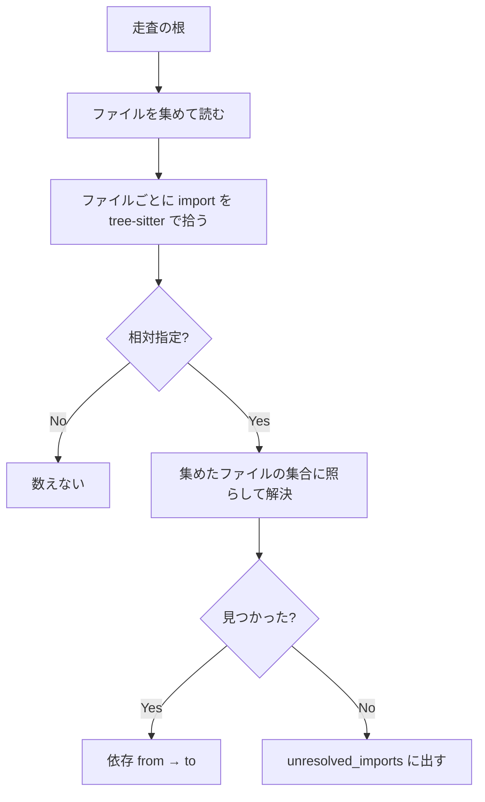

# tightrope report - 依存の取り方仕様（バックエンド）

> **機能**: [tightrope report（MVP）](./index.md)

## 概要

走査の根の下の TypeScript ファイルを集め、import を拾って、どのファイルがどのファイルに依存しているか（`from` → `to`）を決める。依存の強度は [strength-spec.md](./strength-spec.md) が決める。

## ビジネスロジック

| ID | ルール | 条件 | 振る舞い |
|:---|:-------|:-----|:---------|
| DEP-001 | 集めるファイル | 拡張子が `.ts` / `.tsx` / `.mts` / `.cts` | module にする（`.d.ts` も含む） |
| DEP-002 | 降りないディレクトリ | 依存・生成物の置き場（`node_modules` / `dist` / `build` など） | 降りない。一覧は dryguard の `codebase` と同じものを移植する |
| DEP-003 | `.gitignore` | — | 読まない |
| DEP-004 | 拾う import | `import` / `export ... from` / `require()` / `import x = require()` / `import type` | 依存の宣言として拾う。動的 `import()` は拾わない |
| DEP-005 | 相対指定の解決 | 指定子が `./` / `../` で始まる | **集めたファイルの集合に照らして**解決する（下の「解決の順」） |
| DEP-006 | パッケージ名の指定 | 相対でない指定子（`react` など） | 走査の外なので依存にしない。数えもしない |
| DEP-007 | 解決できなかった相対指定 | どの候補も集合に無い | 依存にせず、`unresolved_imports` に位置と指定子を出す。**黙って捨てない** |
| DEP-008 | 依存先 | 解決できた | `to` は **import が解決したファイル**。`index.ts` 経由なら `index.ts`（宣言が書かれたファイルではない） |
| DEP-009 | 自分自身 | `from` と `to` が同じ | 依存にしない |
| DEP-010 | 同じ相手への複数の import | 1 つのファイルが同じ `to` を 2 回以上 import | 依存は 1 本にまとめ、evidence を合わせる |

### 解決の順

指定子を `from` のディレクトリから畳んだパス `P` について、次の順で最初に集合にあったものを `to` にする。

1. `P` そのもの（拡張子付きで書かれている場合）
2. `P` + `.ts` / `.tsx` / `.mts` / `.cts` / `.d.ts`
3. `P/index` + 同じ拡張子の並び

TypeScript の ESM で書く `./foo.js`（実体は `foo.ts`）は、`.js` / `.jsx` / `.mjs` / `.cjs` を対応する TypeScript の拡張子に置き換えてから 1. と 2. を試す。

**Why（集合に照らす）**: 解決をファイルシステムの問い合わせにすると、解析の段が I/O を持つ。集めたファイルの集合は既にあるので、照合だけで足りる。

**Why not（dryguard の `ModulePath` をそのまま使う）**: dryguard は同じ依存先を共有しているかを見るだけなので、指定子を綴りのまま畳めば足りた。tightrope は依存の相手をファイルとして特定する必要がある。

**Why（`to` を import の解決先にする）**: `index.ts` を経由した import は公開口に依存しており、それが結合の相手として正しい。宣言の場所を `to` にすると、`to` が LSP の有無で変わる。

### 処理フロー

## エラーハンドリング

| エラーケース | 発生条件 | 振る舞い |
|:------------|:---------|:---------|
| ファイルが読めない | 権限・UTF-8 でない | そのファイルを外し、件数とパスを出す |
| 構文エラーを含むファイル | tree-sitter が ERROR ノードを返す | 拾えた import だけを使う。構文エラーを含むファイルの数を出す |

## 制限事項

- tsconfig の `paths` / `baseUrl` によるエイリアスは解決しない（相対でない指定子として数えない側に入る）
- package.json の `exports` / `imports` フィールドは読まない
- monorepo のパッケージ名による import（`@my/lib`）は、走査の根の中にあっても依存にしない
- 動的 `import()` は拾わない

## 関連仕様

- [strength-spec.md](./strength-spec.md) - 拾った import から evidence と強度を決める
- [distance-volatility-spec.md](./distance-volatility-spec.md) - `from` と `to` から距離を測る
- [technical-spec.md](./technical-spec.md) - dryguard の import 抽出の移植
