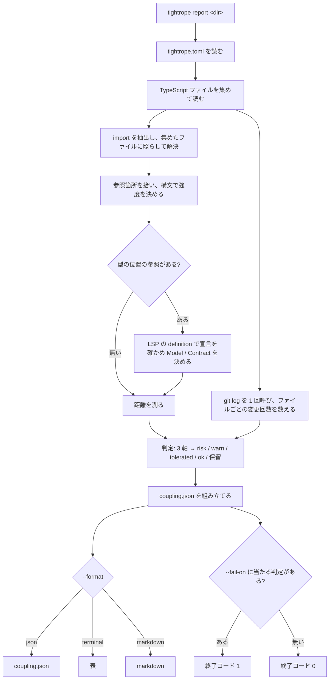

# tightrope report（MVP）

> **作成日**: 2026-11-18
> **土台**: [tightrope 計画書](../tightrope-plan.md)（構想とモデル。この仕様書は MVP の分だけを決める）

## 概要

`tightrope report <dir>` は、TypeScript のコードベースのファイル間の依存 1 本ごとに「統合強度・距離・変動性」を測り、『ソフトウェア設計における結合のバランス』（Vlad Khononov）のモデルでバランスを判定して、**理由付きで**出す。結果はすべて `coupling.json` に入り、terminal の表と markdown はそこから作る。

## 背景

- 既存の結合ツールは 1 言語専用か、import の有無だけを見る（強度を区別しない）
- 「密結合だが、ほとんど変わらないので許容できる」のような判断は、3 軸を揃えて見ないと出せない
- MVP では 1 言語（TypeScript）を縦に通し、判定ロジックと `coupling.json` を固める。HTML レポートや他の言語はその上に足す

## スコープ

**対象範囲**:
- TypeScript（`.ts` / `.tsx` / `.mts` / `.cts`）
- module＝ファイル、依存＝ファイルからファイルへ
- 統合強度 4 段（Intrusive / Functional / Model / Contract）・距離 3 段・変動性（git 履歴）
- 判定 4 つ（risk / warn / tolerated / ok）と「保留」、判定の理由（reason）と根拠（evidence）
- 出力：`coupling.json`・terminal の表・markdown
- `--fail-on` による CI での失敗
- `tightrope.toml` によるしきい値の変更

**対象外**:
- Rust / Java / Swift
- HTML レポート・依存マップ・数値スコア・不安定度 I
- co-change（一緒に変わるファイル）
- チーム（CODEOWNERS）による距離
- tsconfig の `paths` エイリアスの解決
- パスの規約（`contracts/` / `dto/`）による Model / Contract の補正、`as any` による Intrusive
- dryguard との共通 crate（MVP はコピーで移植する）
- 性能の目標値

## ユーザーストーリー

| ID | ～として | ～したい | ～のために | 優先度 |
|:---|:---------|:---------|:-----------|:-------|
| US-001 | 自分のリポジトリを開発する人 | 依存ごとの判定と理由を terminal で見たい | どの結合から手を入れるべきかを決める | 高 |
| US-002 | 自分のリポジトリを開発する人 | 判定の根拠になったコードの位置（`ファイル:行`）を知りたい | 該当箇所へすぐ飛ぶ | 高 |
| US-003 | CI を組む人 | risk（または warn）があれば CI を落としたい | 密結合が増えたことにマージ前に気づく | 高 |
| US-004 | CI を組む人 | 結果を markdown で受け取りたい | PR コメントに貼る | 中 |
| US-005 | 後から HTML などの出力を作る人 | すべての結果を 1 つの JSON で受け取りたい | 判定をやり直さずに見せ方だけを作る | 高 |
| US-006 | 自分のリポジトリを開発する人 | 強い / 遠い / 変わりやすいの線を変えたい | プロジェクトの規模に合わせる | 中 |
| US-007 | git や LSP が無い環境で使う人 | 取れなかった値が「取れなかった」と分かる形で出てほしい | 測れなかったのか、問題が無かったのかを区別する | 高 |

## 処理フロー

## 仕様書一覧

| 仕様書 | 説明 |
|:-------|:-----|
| [cli-spec.md](./cli-spec.md) | コマンドの引数・終了コード・`--fail-on`・`tightrope.toml` |
| [dependency-spec.md](./dependency-spec.md) | ファイルの収集・import の抽出と解決・解決できなかった import |
| [strength-spec.md](./strength-spec.md) | 統合強度 4 段の決め方・LSP が答えないとき |
| [distance-volatility-spec.md](./distance-volatility-spec.md) | 距離 3 段・git 履歴による変動性・取れなかったとき |
| [judgement-spec.md](./judgement-spec.md) | しきい値と既定値・判定表・保留・reason |
| [coupling-json-spec.md](./coupling-json-spec.md) | `coupling.json` のスキーマ（出力の唯一の入力） |
| [output-spec.md](./output-spec.md) | terminal の表と markdown の見せ方 |
| [technical-spec.md](./technical-spec.md) | 段の構成・I/O の境界・dryguard からの移植・エラー処理 |

## 非機能要件

| カテゴリ | 要件 | 目標値 |
|:---------|:-----|:-------|
| 再現性 | 同じ入力（ソース・git 履歴・設定）から同じ `coupling.json` が出る | 配列の並びを決定的にする |
| 可搬性 | LSP サーバ・git が無くても動き、取れなかった分を理由付きで出す | — |
| 性能 | MVP では目標値を置かない | — |

## 用語集

| 用語 | 定義 |
|:-----|:-----|
| module | 結合を測る単位。MVP では走査の根の下の TypeScript ファイル 1 つ |
| dependency（依存） | ある module から別の module への依存 1 本。`from` は import を書いた側、`to` は import が解決したファイル |
| evidence | 依存の根拠になった参照箇所 1 つ。`ファイル:行` と、その箇所の強度 |
| refs | 依存 1 本が持つ evidence の数 |
| package | そのファイルから上へ辿って最初に見つかる `package.json` のディレクトリ |
| strength（統合強度） | Intrusive / Functional / Model / Contract の 4 段 |
| distance（距離） | same-directory / other-directory / other-package の 3 段 |
| volatility（変動性） | 依存先ファイルの、期間内の git の変更回数 |
| verdict（判定） | risk / warn / tolerated / ok |
| 保留（undetermined） | 判定に効く値が取れず、判定できなかったこと。verdict の 5 つ目ではない |
| reason | 判定を傾けた根拠 1 件。軸・値・当てたしきい値・向きの組 |
| coupling.json | 解析結果のすべてを持つ JSON。出力はこれだけを入力にする |
